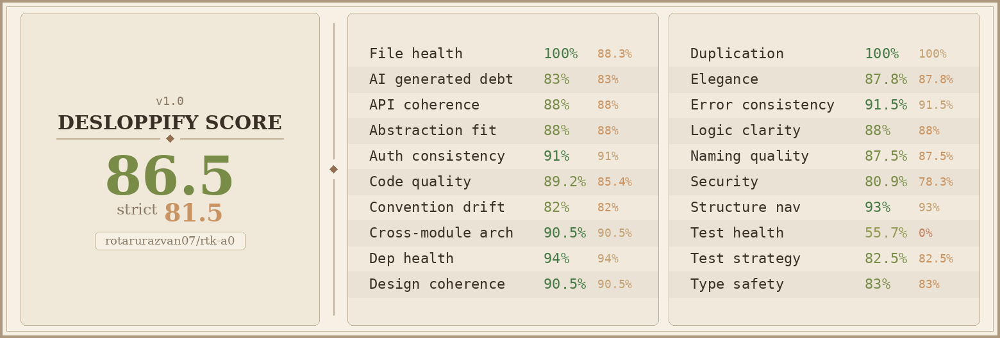

# RTK Compression for Agent Zero


Cut the token cost of terminal output in Agent Zero, without changing how you work.

This plugin routes every terminal command through [RTK](https://github.com/rtk-ai/rtk), a CLI that rewrites commands so their output is compressed before it reaches the agent's context. Less noise, fewer tokens, same result.

**Fail-open by design:** if RTK is missing, slow, or errors out, your original command runs unchanged. Worst case, you get uncompressed output.

## Install

**Option 1: Plugin Hub**
Search for **rtk** in Agent Zero's Plugin Hub and install.

**Option 2: Git clone**

```bash
git clone https://github.com/rotarurazvan07/rtk-a0.git usr/plugins/rtk_compression
```

## How it works

1. On install or update, `scripts/setup.sh` downloads the RTK release pinned in `rtk_pin.txt` (currently `v1.0.1`, static musl build), verifies its SHA-256 against the release `checksums.txt`, and installs it to `/usr/local/bin/rtk`.
2. Before each terminal command runs, the plugin calls `rtk rewrite <command>`.
3. If RTK returns a rewrite, that runs instead. Otherwise the original command runs.

**Automatic recovery:** if the RTK binary is missing or its version no longer matches `rtk_pin.txt` — for example after a container restart or an image rebuild — the plugin re-provisions it in the background the next time Agent Zero starts. No configuration is needed, and the check costs one `rtk --version` call when the binary is already correct. Uninstalling the plugin still leaves the user-owned binary at `/usr/local/bin/rtk` in place.

Rewritten commands still pass through Agent Zero's normal permission layer. The plugin never bypasses approvals.

## Check that it's working

Ask the agent to run:

```
rtk gain
```

This shows RTK's own savings ledger: total tokens saved and a per-command breakdown.

Savings depend on the command. Output-heavy commands compress well; tiny outputs can even grow slightly.

### Example

| Command | Before | After | Reduction |
| --- | --- | --- | --- |
| `git status` | 476 B | 125 B | 73.7% |

## Usage

No configuration needed. A few useful things to know:

- Commands you prefix with `rtk` yourself (`rtk gain`, `rtk --version`) pass through untouched.

### Savings page — RTK's totals on demand

Run **`rtk-gain`** from the command palette to open a read-only savings
page. It fetches RTK's own accounting **once, when the page opens**, and
shows the totals **as RTK formats them** — tokens saved and the savings
percentage come from RTK's ledger; this plugin never recomputes or re-rounds
them. While the page is closed there is **no background polling and no network
traffic**, and the plugin persists nothing.

When RTK's ledger is empty (fresh install, no tracked commands yet) the page
says so instead of showing zeros. When the RTK binary is unavailable, the
page shows a notice pointing at the Troubleshooting section below — never an
error page, and the agent keeps working either way.

- **Want raw output?** Use `rtk bypass <command>`:

```
  rtk bypass ls -la
```

## Fail-open guarantee

Your command always runs. Each of these cases falls back to the original command:

- RTK not found on `PATH` (one warning per session)
- Rewrite takes longer than 2 seconds
- RTK exits with an error (except rc 3, see below)
- Empty or identical rewrite output
- Any internal plugin error

## Troubleshooting

**"rtk unavailable — running uncompressed" warning**
The RTK binary isn't on `PATH`. Re-run setup from the plugin directory (safe to repeat):

```bash
RTK_INSTALL_DIR=/usr/local/bin bash scripts/setup.sh
rtk --version
```

Then restart the session and run `rtk gain`.

**Setup couldn't download RTK**
Offline container, network block, or checksum mismatch. Setup logs one warning and exits cleanly; the plugin works uncompressed until the binary is available.

**RTK exits with rc 3**
This is RTK's allow-rules notice. The rewrite is still applied, and Agent Zero's permission layer handles approval as usual.

## Uninstall

Removing the plugin deletes the plugin files only. The RTK binary at `/usr/local/bin/rtk` is left in place; delete it yourself if you want it gone.

## License

This plugin is **Apache-2.0** (see `LICENSE`).

RTK is a separate **BUSL-1.1** project. This plugin downloads the RTK binary at setup time and calls it as `rtk rewrite <command>`. It does not vendor, embed, or reimplement any RTK code.

## Code health

Scored with [desloppify](https://github.com/peteromallet/desloppify), an agent harness that reviews code for quality across 20 dimensions.




## Links

- [RTK project](https://github.com/rtk-ai/rtk)
- [RTK documentation](https://www.rtk-ai.app/docs/)
- [This plugin](https://github.com/rotarurazvan07/rtk-a0)
